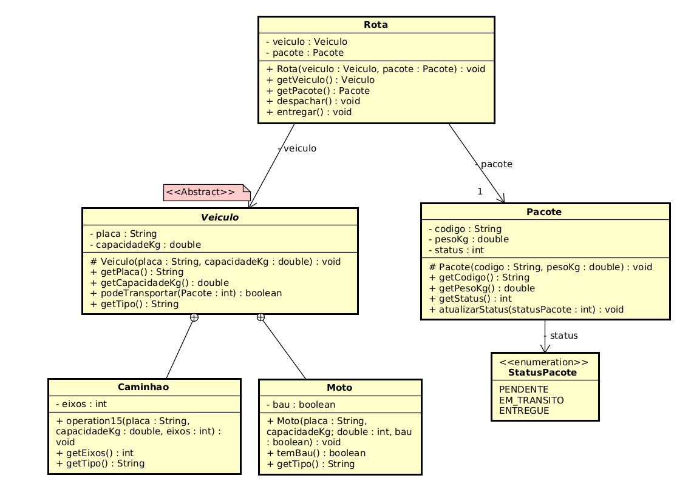
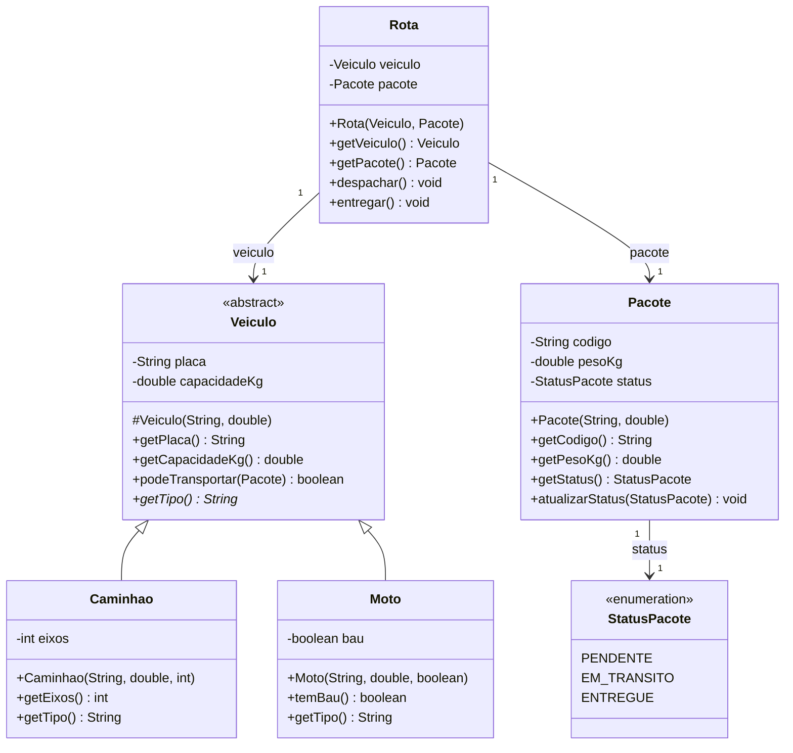

# Check Point 2 - FiapDelivery (refatoracao)

## O que estava errado no legado
Enunciado deu um codigo cru: classes com nome minusculo (`caminhao`,
`moto`, `pacote`), atributos todos public, campo duplicado entre `caminhao` e
`moto` (os dois carregavam `pl` e `cap`), abreviacoes tipo `cod`, `p`, `s`,
metodos com nome sem verbo (`muda`, `vai`), e a `Rota` so aceitava caminhao.
Nao tinha nenhuma validacao: dava pra ter placa vazia, capacidade negativa,
peso negativo, status nulo, pacote entregue voltando pra pendente.

## O que eu mudei

Cada mudanca abaixo tem um porque curto na frente.

- Renomeei tudo pra PascalCase no singular (`Veiculo`, `Caminhao`, `Moto`,
  `Pacote`, `Rota`), porque classe e substantivo e o legado tava fora do padrao.
- Troquei as abreviacoes por nomes de dominio: `pl` virou `placa`, `cap` virou
  `capacidadeKg`, `cod` virou `codigo`, `p` virou `pesoKg`, `s` virou `status`.
  `capacidadeKg` e `pesoKg` ja carregam a unidade no proprio nome, entao ninguem
  precisa adivinhar se e libra ou tonelada.
- `muda` virou `atualizarStatus` e `vai` virou `despachar`. Metodo e verbo no
  infinitivo, e o novo nome diz o que faz.
- Subi `placa` e `capacidadeKg` pra uma classe `Veiculo` abstrata, porque estavam
  duplicados em `Caminhao` e `Moto` (regra do "E UM"). O construtor ficou
  `protected` pra so as subclasses instanciarem.
- `Caminhao` tem `eixos` e `Moto` tem `bau`, cada um com o que e proprio dele.
- `Veiculo.podeTransportar(Pacote)` compara peso com capacidade. Peguei o nome
  no vocabulario de logistica: e mais explicito do que um generico `suporta`.
- `Rota` recebe `Veiculo` (tipo base) e um `Pacote`, e valida no construtor que
  o veiculo aguenta o pacote. Resolve o pior bug do legado, que era a Rota so
  aceitar caminhao. Com o tipo base ela serve pros dois.
- `Rota.despachar()` marca EM_TRANSITO e `Rota.entregar()` marca ENTREGUE. Casei
  o nome do metodo com o nome do estado final (`StatusPacote.ENTREGUE`) pra
  ninguem ter que traduzir na cabeca.
- `Pacote` nasce sempre PENDENTE e usa enum `StatusPacote` (nada de string
  magica).
- Atributos todos `private`. Os que sao imutaveis (placa, capacidade, codigo,
  peso) sao `final` e nao tem setter nenhum. Status muda so pelo
  `atualizarStatus`, que aplica a regra (nao aceita null, nao deixa mexer em
  pacote ja entregue).
- Todos os getters `public`. O `-` do UML e sobre o atributo, nao sobre o getter
  (foi onde eu errei na prova anterior).
- Validacoes com `IllegalArgumentException` pra argumento invalido e
  `IllegalStateException` pra transicao invalida. Fail-fast no construtor.

## Como rodar

```
cd FiapDelivery
rm -rf bin
javac -d bin $(find src -name '*.java')
java -cp bin br.com.fiapdelivery.main.SistemaPrincipal
```

`SistemaPrincipal` tem 3 cenarios:

1. Rota com Caminhao: despacha e entrega.
2. Rota com Moto: prova que a mesma Rota serve pros dois tipos (polimorfismo).
3. Bateria de casos invalidos rodando via try/catch, cada um deve imprimir
   `[OK]` com a mensagem da excecao. Cobre placa vazia, capacidade negativa,
   caminhao com 1 eixo, moto com capacidade 0, codigo nulo, peso negativo,
   status nulo, mexer em pacote entregue, rota com veiculo/pacote nulo, pacote
   pesado demais pra moto, despachar sem estar pendente, e entregar antes de
   despachar.

## Diagrama de classes

Fonte no Astah (`diagrama.asta`) com o PNG exportado em `image.png`. Deixei
tambem a versao em Mermaid porque e legivel em texto puro e facil de conferir
num diff.





## Estrutura

```
FiapDelivery/
├── README.md
├── diagrama.asta
├── image.png
└── src/br/com/fiapdelivery/
    ├── main/SistemaPrincipal.java
    └── model/
        ├── Veiculo.java        (abstract)
        ├── Caminhao.java
        ├── Moto.java
        ├── Pacote.java
        ├── Rota.java
        └── StatusPacote.java   (enum)
```
